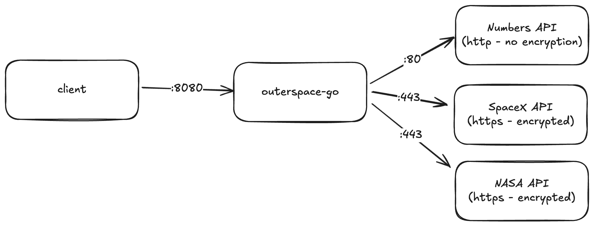
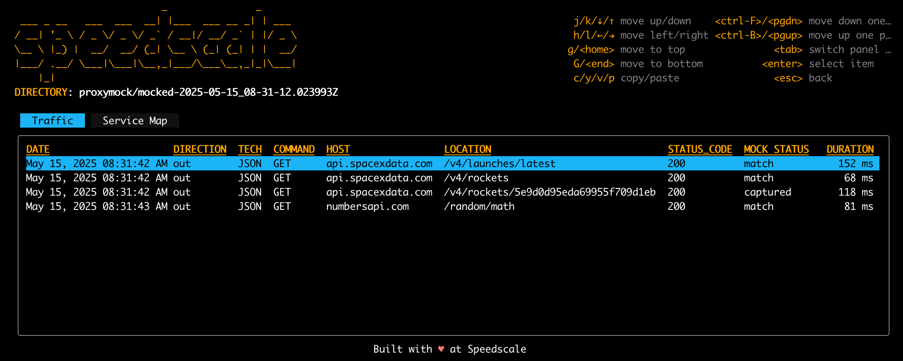

# Demo App: outerspace-go

[](https://github.com/speedscale/outerspace-go/actions/workflows/ci-cd.yml)

Outerspace is a Go HTTP and gRPC demo with launch, rocket, math fact and astronomy endpoints. Its outbound requests use frozen demo data on Speedscale's AWS S3 and CloudFront backend, avoiding retired APIs and public API quotas. The sample data is synthetic and is not current SpaceX or NASA data. The application still makes real outbound HTTPS calls for traffic capture, mocking and replay.



# Working Locally

## How to run the go app locally

This will run a server on port `:8080` with the API endpoints.
```
go run main.go
```

Once the app is running you can make API requests.

The simplest way to make a bunch of requests is to run the build in client
script.
```
cd cmd/client
go run .
```

But you can also make requests directly.

```
curl localhost:8080/api/latest-launch
```

Request with no path to see the full list of API endpoints:
```
curl localhost:8080/ | jq
{
  "/": "Shows this list of available endpoints",
  "/api/latest-launch": "Get the latest SpaceX launch",
  "/api/numbers": "Get a random math fact",
  "/api/rocket": "Get a specific rocket by ID (use ?id=[rocket_id])",
  "/api/rockets": "Get a list of all SpaceX rockets"
}

```

## How to run the tests locally

There are unit tests all through the code that you can easily run:
```
go test -v ./...
```

## Upstream configuration

The default backend is `https://demo-api.trafficreplay.com/outerspace`. Set `DEMO_UPSTREAM_BASE_URL` to use a different deployment of the [reference backend](https://github.com/speedscale/mock-lab/tree/main/shared). Its static export must contain the `outerspace/` objects before the app is deployed. No API key is required for demo data.

`SPACEX_BASE_URL`, `NUMBERS_BASE_URL` and `NASA_BASE_URL` independently override each upstream. Each accepts the API root, before `/rockets.json` (and `/rockets/{id}`), `/random/math` or `/planetary/apod`. Set both `NASA_BASE_URL=https://api.nasa.gov` and `NASA_API_KEY` only when deliberately using the live NASA API. The app sends no NASA key to its default demo backend. The launch summary fetches the static launch list with GET and filters the last three years locally.

Existing HTTP paths and response fields are preserved. Missing or failed upstream responses remain errors; the app does not silently substitute successful data. CI checks the HTTP handlers and upstream failure cases against an in-process reference server without cloud credentials.

# proxymock

[proxymock](https://proxymock.io/) records, mocks and replays the app's HTTP dependencies. Record fresh traffic when changing the upstream URL; the old committed SpaceX, Numbers and NASA recordings target different hosts.

## Record with proxymock

All you have to do is set the following environment variables before you run the go code:
```
export http_proxy=http://localhost:4140
export https_proxy=http://localhost:4140
export grpc_proxy=http://$(hostname):4140
go run main.go
```

Then in a new terminal window run `proxymock record` to start recording:
```
proxymock record
```

Now, in yet another new terminal window, run the script to make requests to the server:
```
go run cmd/client/main.go
```

Note that this will only record requests made from the API server to the external APIs.  To record the requests from the client you will need to export the same proxy environment variables in that terminal.

For examples of the kind of data collected, check the `proxymock` directory of the repository. If you want to see what the data looks like, you can use the inspect command, it will automatically show you all the data in the `proxymock` directory.

```
proxymock inspect
```

### API List

You can see a list of every API call that was recorded, both inbound to your application and outbound to downstream systems.


### Drill-down

Using your arrow keys you can navigate to a particular call and see all the details of what request was sent and how the application responded. Here we can see the exact value returned from the Numbers API.


If you want to run a mock server with all of those recorded responses, you can easily launch it with:
```
proxymock mock
```

Now if another terminal window you can run the `outerspace-go` application:
```
export http_proxy=http://localhost:4140
export https_proxy=http://localhost:4140
export grpc_proxy=http://$(hostname):4140
go run main.go
```

In a third terminal window you can either use `curl` or just run through all the API client requests with:
```
go run cmd/client/main.go
```

You can see all the calls that were mocked out by running this (put in the correct TIMESTAMP from your machine):
```
proxymock inspect --in proxymock/mocked-TIMESTAMP
```



# Learn More?

Feel free to join the [Speedscale Community](https://speedscale.com/community/) to learn more ways to use `proxymock` on your next project!

## Version Management

Use the Makefile to manage versions and releases:
- `make version` - Show current version
- `make bump-patch` - Bump patch version 
- `make bump-minor` - Bump minor version
- `make bump-major` - Bump major version
- `make tag` - Create and push git tag for current version
- `make release-patch` - Bump patch version, create tag, and trigger CI
- `make release-minor` - Bump minor version, create tag, and trigger CI  
- `make release-major` - Bump major version, create tag, and trigger CI